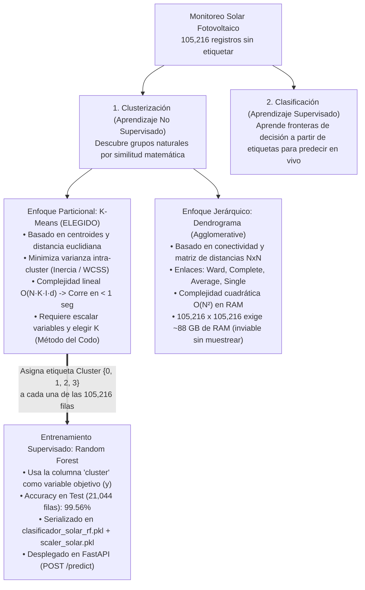

# 📘 Guía y Explicación Completa del Proyecto — Evaluación 3 y Evaluación 4 (Planta Solar Lechuzas)

Este documento explica **de principio a fin** todo lo que hicimos, por qué se tomó cada decisión técnica, qué resultados reales arrojó el código sobre las **105,216 filas** de `10 - lechuzasdataset.csv`, y qué archivo corresponde a cada punto que pide el profesor en el PDF.

---

## 1. ¿De qué trata el Desafío y cuál era el problema a resolver?

Una empresa de energía solar tiene **105,216 registros** de sensores de sus paneles fotovoltaicos (`10 - lechuzasdataset.csv`) con 5 columnas:
* `id`: Número correlativo de la fila (`0` a `105,215`).
* `Potencia`: Potencia eléctrica del inversor en Watts (`-3,133 W` a `+11 W`).
* `Radiacion`: Irradiancia solar medida por el sensor en W/m² (`-10 W/m²` a `1,321 W/m²`).
* `Temperatura`: Temperatura ambiente en °C (`-6 °C` a `48 °C`).
* `Temperatura panel`: Temperatura en la superficie del panel en °C (`-8 °C` a `61 °C`).

### El Problema Técnico Principal
A diferencia de un dataset clásico de clasificación (donde ya viene una columna `target_class` que dice a qué categoría pertenece cada fila), **este dataset NO trae etiquetas**. No sabemos de antemano cuántos regímenes operativos existen ni a cuál pertenece cada medición.

### Nuestra Solución en 2 Fases (No Supervisado $\rightarrow$ Supervisado en Producción)
1. **Fase 1 — Descubrir y Etiquetar (Aprendizaje No Supervisado con K-Means)**:
   Usamos `01_clusterizacion_y_eda.py` para agrupar matemáticamente las 105,216 lecturas según su comportamiento físico. Descubrimos que la planta opera en **4 regímenes solares ($k = 4$)** y le asignamos a cada fila su etiqueta (`cluster` `0`, `1`, `2` o `3`).
2. **Fase 2 — Automatizar en Producción (Aprendizaje Supervisado con Random Forest + FastAPI)**:
   Usamos `02_entrenar_clasificador.py` para tomar esa nueva columna `cluster` como variable objetivo (`y`), entrenar un `RandomForestClassifier` (que logró **99.56% de exactitud**), guardarlo en archivos `.pkl` (`clasificador_solar_rf.pkl` y `scaler_solar.pkl`) y conectarlo al servidor web `main.py` (**FastAPI**) para clasificar nuevas lecturas en tiempo real.

---

## 2. Qué archivo corresponde a cada Entregable del PDF

### 📦 Evaluación 3 (Ev. 3): Teoría, Implementación y Producción (Lo que se entrega primero)

| Entregable que pide el PDF | Archivos de tu carpeta `Desafio_Lechuzas/` que lo cumplen | Qué contiene |
| :--- | :--- | :--- |
| **1. Mapa Conceptual Teórico** *(K-Means vs. Dendrograma vs. Clasificación)* | • `03_mapa_conceptual_y_presentacion.html` (Sección 1) • `EXPLICACION_COMPLETA_PROYECTO.md` (Sección 3) | Comparación matemática, ventajas, desventajas, complejidad en memoria RAM y tabla de métricas internas vs. supervisadas. |
| **2. Algoritmo Implementado y Explicado** *(EDA, limpieza, elección de K y análisis físico)* | • `01_clusterizacion_y_eda.py` • `Notebook_Ev3_Segmentacion_Fotovoltaica.ipynb` • `graficos/metricas_evaluacion_k.csv` • `10 - lechuzas_etiquetado.csv` | Limpieza de `id`, truncado de radiación negativa a `0.0`, escalamiento `StandardScaler`, tabla de $k=2..6$ con las 4 métricas y perfil físico de los 4 clusters. |
| **3. Automatización en Producción** *(Pipeline `.pkl` + Servicio de inferencia)* | • `02_entrenar_clasificador.py` • `main.py` (Servidor FastAPI) • `models/clasificador_solar_rf.pkl` • `models/scaler_solar.pkl` | Entrenamiento del clasificador supervisado (`99.56%` Accuracy), serialización `.pkl` y endpoint `POST /predict` con alertas térmicas/eléctricas, clima y fase lunar. |

### 🎤 Evaluación 4 (Ev. 4): Comunicación y Defensa Técnica (Lo que se expone al profesor)
* **Presentación Ejecutiva/Técnica**: Abres `03_mapa_conceptual_y_presentacion.html` en el navegador (tiene el mapa conceptual, el gráfico del Método del Codo, las tarjetas de los 4 clusters y un simulador interactivo) junto con `http://127.0.0.1:8000/docs` para mostrar la API respondiendo en vivo.
* **Interrogación Oral**: En la **Sección 6** de este documento (y al final del HTML) están las preguntas exactas que hace el profesor con sus respuestas técnicas.

---

## 3. Entregable 1 Detallado: Mapa Conceptual Teórico

### Comparación Técnica: K-Means vs. Clustering Jerárquico vs. Clasificación

| Criterio | K-Means (Particional) | Clustering Jerárquico (Dendrograma) | Clasificación Supervisada (Random Forest) |
| :--- | :--- | :--- | :--- |
| **¿Necesita etiquetas para entrenar?** | **No** (No Supervisado). | **No** (No Supervisado). | **Sí** (Supervisado: usa los clusters de K-Means como etiquetas `y`). |
| **Fórmula / Principio matemático** | Minimiza la suma de distancias al cuadrado a cada centroide: $WCSS = \sum_{k=1}^K \sum_{x_i \in C_k} \|x_i - \mu_k\|^2$ | Calcula todas las distancias entre pares $d(x_i, x_j)$ y une grupos según criterio de enlace (*Ward* minimiza varianza al fusionar). | Construye 100 árboles de decisión reduciendo la impureza de Gini en cada división y vota por mayoría. |
| **Memoria y Tiempo en 105,216 filas** | **Muy eficiente**: memoria $O(N)$, tiempo $< 1\text{ s}$. | **Colapsa en memoria**: matriz $105,216^2 \times 8\text{ bytes} \approx 88.5\text{ GB}$ de RAM. | **Muy rápido en producción**: $< 5\text{ ms}$ por predicción en FastAPI. |
| **Ventajas principales** | Escalable a millones de datos; sus centroides entregan el perfil físico promedio de cada régimen solar. | No obliga a elegir $K$ antes de correr; el dendrograma permite visualizar subgrupos jerárquicos. | Entrega probabilidad de confianza (`predict_proba`), maneja ruido y permite clasificar nuevos registros al instante. |
| **Desventajas principales** | Sensible a escalas distintas (exige `StandardScaler`) y asume clusters convexos/esféricos. | No puede aplicarse sobre los 105k registros completos y no tiene método `.predict()` nativo para nuevos puntos. | Depende de la calidad de las etiquetas generadas previamente en la etapa de clusterización. |

---

## 4. Entregable 2 Detallado: Preprocesamiento, Selección de $K$ y Análisis Físico (`01_clusterizacion_y_eda.py`)

### 4.1 Tres Decisiones Críticas de Preprocesamiento
1. **Eliminación de la columna `id`**:
   `id` solo enumera las filas de `0` a `105,215`. Si no se elimina con `df.drop(columns=["id"])`, K-Means calcularía distancias usando el número de fila y agruparía por fecha/orden del archivo en lugar de agrupar por comportamiento eléctrico y térmico.
2. **Corrección de valores negativos en `Radiacion` (`45,142` registros)**:
   En el dataset existen 45,142 filas nocturnas donde la radiación vale entre `-1.0` y `-10.0 W/m²`. Esto ocurre porque durante la noche la cúpula de vidrio del sensor piranómetro se enfría hacia el cielo despejado y genera un pequeño voltaje negativo (*offset térmico nocturno*). Como físicamente **no existe radiación solar negativa**, se aplicó `df["Radiacion"] = df["Radiacion"].clip(lower=0.0)`.
3. **¿Por qué `Potencia` sí se deja negativa?**:
   En `Potencia`, los valores llegan a `-3,133 W` al mediodía y valen `+8 W` de noche. Eso **no es un error**: es la convención eléctrica del medidor bidireccional del inversor, donde el **signo negativo indica energía generada/inyectada a la red** y el **signo positivo indica consumo en espera (standby) nocturno**.
4. **Escalamiento con `StandardScaler`**:
   Como K-Means mide distancias euclidianas, una variable que varía en miles (`Potencia`: `-3133` a `11`) aplastaría a una variable que varía en decenas (`Temperatura`: `-6` a `48`). Con `StandardScaler`, las 4 variables (`Potencia`, `Radiacion`, `Temperatura`, `Temperatura panel`) pasan a tener media `0` y desviación estándar `1`.

### 4.2 Resultados Reales de la Evaluación de Hiperparámetros ($k = 2..6$)
Al ejecutar `01_clusterizacion_y_eda.py` sobre las 105,216 filas escaladas, se obtuvieron estas métricas (guardadas en `graficos/metricas_evaluacion_k.csv`):

| Número de Clusters ($k$) | Inercia (WCSS - Método del Codo) | Silhouette Score (Muestra 10k) | Índice Davies-Bouldin (Menor es mejor) | Índice Calinski-Harabasz (Mayor es mejor) | Interpretación |
| :---: | :---: | :---: | :---: | :---: | :--- |
| **$k = 2$** | `102,651.4` | `0.6910` | `0.4902` | `326,156.8` | Demasiado simple: solo divide **Noche vs. Día**. |
| **$k = 3$** | `72,264.5` | `0.5794` | `0.8139` | `253,772.4` | Separa Noche, Día Medio y Día Alto, pero mezcla amanecer/nublado con noche. |
| **$k = 4$ (Óptimo)** | **`53,214.3`** | **`0.4345`** | **`0.8740`** | **`242,304.7`** | **Codo óptimo**: la inercia cae un 87% respecto a $k=1$ (`420,864`) y distingue los **4 regímenes físicos reales**. |
| **$k = 5$** | `44,616.7` | `0.4117` | `0.9225` | `221,811.7` | Empeora Silhouette y Davies-Bouldin al subdividir artificialmente la noche en noche fría y noche templada. |
| **$k = 6$** | `37,498.4` | `0.4247` | `0.9171` | `215,126.4` | Sobre-segmentación sin ganancia física relevante. |

### 4.3 Perfil Físico y de Negocio de los 4 Clusters Descubiertos ($k = 4$)

| Cluster | Régimen Operativo | Cantidad de Filas (%) | Potencia Media | Radiación Media | Temp. Ambiente | Temp. Panel | $\Delta T$ ($T_{\text{panel}} - T_{\text{amb}}$) | Explicación Física y Operativa |
| :---: | :--- | :---: | :---: | :---: | :---: | :---: | :---: | :--- |
| **Cluster 0** | **Operación Nocturna / Standby** | `43,012` (`40.9%`) | `-32.5 W` | `11.5 W/m²` | `6.6 °C` | `5.8 °C` | `-0.8 °C` | Noche y madrugada fría. Sin radiación solar; el panel está incluso más frío que el aire y el inversor está en espera. |
| **Cluster 1** | **Baja Radiación / Transición** | `29,999` (`28.5%`) | `-163.6 W` | `60.0 W/m²` | `15.0 °C` | `15.0 °C` | `0.0 °C` | Amanecer, atardecer o días muy nublados. El panel entra en equilibrio térmico con el aire e inicia generación baja (~164 W). |
| **Cluster 2** | **Generación Media / Templada** | `14,492` (`13.8%`) | `-1,783.6 W` | `612.4 W/m²` | `21.0 °C` | `25.3 °C` | `+4.3 °C` | Media mañana o media tarde despejada. Régimen de **alta eficiencia térmica**: inyecta ~1.78 kW con calentamiento moderado. |
| **Cluster 3** | **Generación Pico / Alta Temp. Panel** | `17,713` (`16.8%`) | `-2,690.1 W` | `952.6 W/m²` | `32.0 °C` | `39.5 °C` | `+7.5 °C` | Mediodía solar de máxima radiación. Inyecta ~2.69 kW, pero el panel alcanza casi `40 °C` (donde debe monitorearse el estrés térmico). |

---

## 5. Entregable 3 Detallado: Automatización en Producción (`02_entrenar_clasificador.py` + `main.py`)

### 5.1 Entrenamiento del Clasificador Supervisado (`02_entrenar_clasificador.py`)
Una vez generado `10 - lechuzas_etiquetado.csv` con la columna `cluster`:
1. Se separaron las 4 variables predictoras `X` (`Potencia`, `Radiacion`, `Temperatura`, `Temperatura panel`) y la etiqueta `y` (`cluster`).
2. Se dividió el dataset en **80% entrenamiento (`84,172` filas)** y **20% prueba (`21,044` filas)** usando `stratify=y`.
3. Se escaló con `StandardScaler` y se entrenó un `RandomForestClassifier(n_estimators=100, random_state=42)`.
4. **Resultado en el conjunto de prueba (`21,044` filas nunca vistas)**:
   * **Accuracy General**: **`99.56%` (`0.9956`)**
   * **Precision / Recall / F1-Score**: `1.00` en Clusters 0 y 1, y `0.99` en Clusters 2 y 3.
5. Se serializaron en `Desafio_Lechuzas/models/`:
   * `clasificador_solar_rf.pkl` (modelo Random Forest entrenado).
   * `scaler_solar.pkl` (escalador ajustado).

### 5.2 Servicio Web de Inferencia y Alertas (`Desafio_Lechuzas/main.py`)
El archivo `main.py` levanta una API REST con **FastAPI** y validación **Pydantic** (`SensorFotovoltaicoInput`):
* **Qué recibe en `POST /predict`**:
  * Las 4 lecturas del sensor: `Potencia`, `Radiacion`, `Temperatura`, `Temperatura panel`.
  * **Variables asociadas contextuales** (como pide el enunciado del desafío): `condicion_climatica` (ej. *"Despejado"*, *"Nublado"*, *"Polvo en suspensión"*) y `fase_lunar` (ej. *"Luna Llena"*, *"No aplica (Diurno)"*).
* **Qué automatiza por dentro en cada petición**:
  1. Limpia automáticamente cualquier lectura negativa de radiación (`max(0.0, data.radiacion)`).
  2. Escala las 4 variables con `scaler_solar.pkl`.
  3. Predice el `cluster` (`0, 1, 2, 3`) y calcula su probabilidad de confianza (`predict_proba`).
  4. Calcula la potencia real generada en Watts (`abs(Potencia)` si es negativa) y el diferencial térmico del panel ($\Delta T = T_{\text{panel}} - T_{\text{ambiente}}$).
  5. Evalúa **reglas automáticas de negocio y mantenimiento**:
     * Si `Radiacion > 400 W/m²` pero `Potencia >= 0`: dispara **`ALERTA CRÍTICA: Alta radiación sin generación eléctrica (posible falla en inversor/fusible)`**.
     * Si `Temperatura panel >= 48 °C` o $\Delta T \ge 15\text{ °C}$: dispara **`ALERTA TÉRMICA: Sobrecalentamiento en superficie del panel (pérdida de eficiencia)`**.

---

## 6. Guía de Interrogación Oral (Evaluación 4): Preguntas y Respuestas para el Profesor

1. **¿Por qué eligieron K-Means y no Clustering Jerárquico (Dendrograma) para implementar en el dataset?**
   * **Respuesta**: Por complejidad computacional y memoria RAM. El dataset tiene `105,216` filas. Un Clustering Jerárquico necesita construir una matriz de distancias de `105,216 × 105,216` (~11 mil millones de distancias), lo que exige más de **88 GB de memoria RAM** ($O(N^2)$). En cambio, K-Means tiene complejidad lineal $O(N \cdot K)$, procesa las 105,216 filas en menos de 1 segundo y entrega centroides directamente interpretables en unidades físicas.

2. **¿Por qué si `Silhouette Score` es más alto en $k=2$ (`0.6910`), ustedes eligieron $k=4$ (`0.4345`)?**
   * **Respuesta**: Porque $k=2$ solo separa el fenómeno trivial **Día vs. Noche**, perdiendo toda la información operativa diurna que necesita la empresa solar. Al observar el **Método del Codo (Inercia/WCSS)** junto con el conocimiento del dominio fotovoltaico, el codo real se produce en **$k=4$** (`WCSS = 53,214.3`), logrando separar la operación diurna en sus tres estados físicos reales (*Baja Radiación/Transición*, *Generación Media Templada* y *Generación Pico con Alta Carga Térmica*), además del estado *Nocturno*.

3. **¿Por qué corrigieron los valores negativos en `Radiacion`, pero dejaron negativos los valores de `Potencia`?**
   * **Respuesta**: Porque físicamente la irradiancia solar no puede ser negativa: los valores de `-1` a `-10 W/m²` en `Radiacion` son ruido térmico nocturno del sensor piranómetro, por lo que deben truncarse a `0.0 W/m²`. En cambio, en `Potencia`, el signo negativo (`-3,133 W`) no es ruido sino la convención del medidor bidireccional del inversor para indicar **flujo de energía inyectada hacia la red**, mientras que `+8 W` de noche es energía consumida por el inversor en modo espera.

4. **¿Por qué entrenaron un `RandomForestClassifier` después de hacer K-Means en lugar de poner solo K-Means en producción?**
   * **Respuesta**: Porque transformar los clusters no supervisados en etiquetas para un clasificador supervisado (`RandomForest`) nos permite: 1) obtener una **probabilidad de pertenencia calibrada (`predict_proba`)** para medir la confianza de cada diagnóstico en tiempo real, 2) validar el pipeline con métricas supervisadas estándar (*Accuracy* del `99.56%` y *F1-Score* de `0.99` sobre 21,044 datos de prueba), y 3) tener fronteras de decisión más robustas ante lecturas atípicas de un sensor individual.
