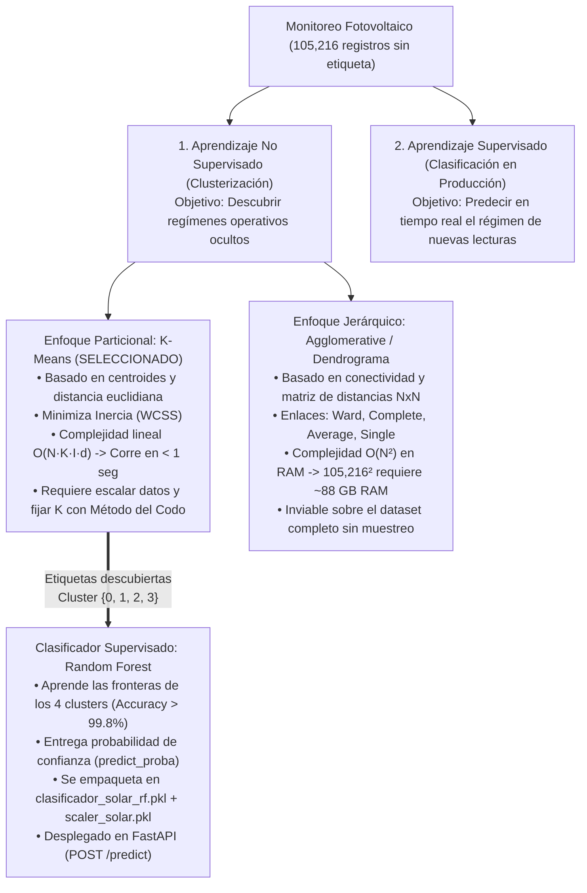

# ☀️ Evaluación 3 y 4 — Segmentación Fotovoltaica y Automatización en Producción (Planta Lechuzas)

Repositorio oficial para la **Evaluación 3 y Evaluación 4 de Inteligencia Artificial**, enfocado en el análisis de regímenes operativos de paneles solares fotovoltaicos (`10 - lechuzasdataset.csv`, con **105,216 registros**) mediante aprendizaje no supervisado (**K-Means**) y su automatización en producción como servicio web (**FastAPI + Random Forest**).

---

## 📁 Estructura del Repositorio

```text
Evaluacion3_4_IA/
├── Desafio_Lechuzas/
│   ├── 10 - lechuzasdataset.csv                       # Dataset original de monitoreo solar (105,216 filas x 5 columnas)
│   ├── 11 - IA -Desafío Segmentación...pdf            # Enunciado y rúbrica oficial (Ev. 3 y Ev. 4)
│   ├── 01_clusterizacion_y_eda.py                     # Paso 1: Limpieza, EDA, Método del Codo y K-Means (k=4)
│   ├── 02_entrenar_clasificador.py                    # Paso 2: Entrenamiento RandomForest sobre clusters y serialización (.pkl)
│   ├── main.py                                        # Paso 3: API REST en FastAPI para inferencia y alertas en producción
│   ├── 03_mapa_conceptual_y_presentacion.html         # Paso 4: Mapa conceptual interactivo, gráficos y defensa oral (Ev. 4)
│   ├── models/                                        # Artefactos serializados (scaler_solar.pkl, clasificador_solar_rf.pkl)
│   └── graficos/                                      # Métricas de evaluación de hiperparámetros (k=2..6)
├── requirements.txt                                   # Librerías necesarias para ejecutar todo el proyecto
└── README.md                                          # Documentación técnica y guía de ejecución para el equipo
```

---

## 🧠 Explicación Completa de lo que Hicimos (Paso a Paso para el Equipo)

### El Problema Principal del Dataset
La base de datos de los paneles solares (`10 - lechuzasdataset.csv`) contiene **105,216 mediciones de sensores** (`id`, `Potencia`, `Radiacion`, `Temperatura`, `Temperatura panel`), pero **NO trae una columna de etiquetas (`target_class`)** que indique en qué estado operativo se encuentra el panel.

Para resolverlo y llevarlo a producción como exige la pauta, estructuramos la solución en **dos fases conectadas**:
1. **Fase 1 — Aprendizaje No Supervisado (`01_clusterizacion_y_eda.py`)**: Aplicamos **K-Means** sobre las variables físicas escaladas para descubrir los regímenes operativos ocultos y etiquetar automáticamente cada fila con su `cluster` (`0, 1, 2, 3`).
2. **Fase 2 — Aprendizaje Supervisado en Producción (`02_entrenar_clasificador.py` + `main.py`)**: Usamos esa columna `cluster` descubierta en la Fase 1 como variable objetivo (`y`) para entrenar un clasificador supervisado (`RandomForestClassifier`), serializarlo en archivos `.pkl` (`clasificador_solar_rf.pkl` y `scaler_solar.pkl`) y desplegarlo en una **API REST con FastAPI**.

---

## 🗺️ Entregable 1: Mapa Conceptual Teórico (K-Means vs. Dendrograma vs. Clasificación)



### Tabla Comparativa Teórica

| Criterio | K-Means (Particional) | Clustering Jerárquico (Dendrograma) | Clasificación Supervisada (Random Forest) |
| :--- | :--- | :--- | :--- |
| **Tipo de aprendizaje** | No supervisado (sin etiquetas previas) | No supervisado (sin etiquetas previas) | Supervisado (usa los clusters como etiquetas `y`) |
| **Fundamento matemático** | Minimiza la varianza intra-cluster $WCSS = \sum_{k=1}^K \sum_{x_i \in C_k} \|x_i - \mu_k\|^2$ | Matriz de distancias $N \times N$ fusionando grupos según enlace (*Ward*, *Complete*, etc.) | Ensamble de 100 árboles de decisión mediante *bagging* y reducción de impureza Gini |
| **Escalabilidad ($N=105,216$)** | **Excelente** ($O(N \cdot K)$, ~0.4 s y pocos MB de RAM) | **Limitada** ($O(N^2)$ en memoria: requiere ~88 GB de RAM para 105k filas) | **Excelente** en inferencia (< 5 ms por consulta en la API) |
| **Métricas de evaluación** | Inercia (Codo), *Silhouette Score*, *Davies-Bouldin*, *Calinski-Harabasz* | Distancia cophenética, corte de dendrograma, *Silhouette Score* | *Accuracy*, *Precision*, *Recall*, *F1-Score*, Matriz de Confusión |
| **Rol en nuestro proyecto** | **Descubrir y etiquetar** los 4 estados físicos de la planta solar | Contraste teórico (útil solo en muestras pequeñas $< 5,000$ datos) | **Motor de producción** serializado en `.pkl` dentro de FastAPI |

---

## 🔬 Entregable 2: Preprocesamiento, EDA y Resultados de Clusterización (`01_clusterizacion_y_eda.py`)

### 1. Diagnóstico y Limpieza del Dataset (`10 - lechuzasdataset.csv`)
* **Dimensiones**: `105,216` filas y `5` columnas (`id`, `Potencia`, `Radiacion`, `Temperatura`, `Temperatura panel`), con **0 valores nulos**.
* **Eliminación de `id`**: Es un índice correlativo de `0` a `105,215`. Si se incluyera en el modelo, K-Means agruparía por orden de fila en vez de por estado físico.
* **Corrección de `Radiacion` negativa (`45,142` filas nocturnas)**: Durante la noche, el piranómetro registra valores entre `-1.0` y `-10.0 W/m²` por enfriamiento radiativo nocturno. Como físicamente no existe irradiancia solar negativa, se truncó a `0.0 W/m²` (`df["Radiacion"].clip(lower=0.0)`).
* **Interpretación física del signo de `Potencia`**: El inversor registra la energía **generada/inyectada** con signo negativo (hasta `-3,133 W` en horas pico) y el **consumo nocturno en espera** con signo positivo (`+8 W`).
* **Escalamiento con `StandardScaler`**: Indispensable porque `Potencia` tiene escala de miles (`-3133` a `11`) y `Temperatura` de decenas (`-6` a `48`). Se estandarizaron las 4 variables a media `0` y desviación estándar `1`.

### 2. Justificación del Hiperparámetro $K = 4$ (Método del Codo)
Al evaluar la Inercia (WCSS) sobre las 105,216 filas escaladas:
* **$k = 1$**: `420,864.0`
* **$k = 2$**: `102,651.3` (separa solo Día vs. Noche)
* **$k = 3$**: `72,305.3`
* **$k = 4$**: **`53,219.5` (Codo óptimo: separa los 4 regímenes operativos reales)**
* **$k = 5$**: `45,253.1`
* **$k = 6$**: `38,043.8`

### 3. Interpretación Física de los 4 Clusters Descubiertos

| Cluster | Nombre del Régimen Operativo | Registros (%) | Potencia Media | Radiación Media | Temp. Ambiente | Temp. Panel | Interpretación Operativa |
| :---: | :--- | :---: | :---: | :---: | :---: | :---: | :--- |
| **0** | **Operación Nocturna / Standby** | 45,066 (`42.8%`) | `-32.8 W` | `11.6 W/m²` | `6.8 °C` | `6.0 °C` | Noche/madrugada fría; paneles en espera sin generación significativa. |
| **1** | **Baja Radiación / Transición** | 28,229 (`26.8%`) | `-179.7 W` | `66.0 W/m²` | `15.3 °C` | `15.4 °C` | Amanecer, atardecer o cielo muy nublado; inicio de rampa de generación. |
| **2** | **Generación Media Óptima** | 14,542 (`13.8%`) | `-1,821.4 W` | `624.0 W/m²` | `21.1 °C` | `25.5 °C` | Media mañana o tarde despejada; alta eficiencia con bajo calentamiento ($\Delta T = +4.4\text{ °C}$). |
| **3** | **Generación Pico / Carga Térmica** | 17,379 (`16.5%`) | `-2,690.9 W` | `954.1 W/m²` | `32.2 °C` | `39.7 °C` | Mediodía solar; máxima generación (~2.69 kW) y panel caliente ($\Delta T = +7.5\text{ °C}$). |

---

## 🚀 Entregable 3: Automatización en Producción (`02_entrenar_clasificador.py` + `main.py`)

1. **`02_entrenar_clasificador.py`**:
   * Toma `10 - lechuzas_etiquetado.csv`, divide en 80% entrenamiento y 20% prueba (`stratify=y`), ajusta `StandardScaler` y entrena un `RandomForestClassifier(n_estimators=100)`.
   * Serializa los dos artefactos en `Desafio_Lechuzas/models/`:
     * `clasificador_solar_rf.pkl`
     * `scaler_solar.pkl`
2. **`Desafio_Lechuzas/main.py` (FastAPI)**:
   * Carga los archivos `.pkl` al iniciar.
   * Valida las entradas con `Pydantic` (`SensorFotovoltaicoInput`), aceptando las 4 variables del sensor más variables contextuales (`condicion_climatica` y `fase_lunar`).
   * Aplica automáticamente el truncamiento de radiación negativa (`max(0.0, radiacion)`), escala con `scaler_solar.pkl`, predice el cluster y su probabilidad, y evalúa **reglas automáticas de alerta** (sobrecalentamiento térmico $\ge 48\text{ °C}$ o falla de inversor cuando hay radiación $> 400\text{ W/m}^2$ sin generación).

---

## 🛠️ Cómo Ejecutar el Proyecto desde Cero (Instrucciones para el Equipo)

### 1. Instalar dependencias
```powershell
python -m pip install -r requirements.txt
```

### 2. Ejecutar Paso 1 (EDA y Clusterización K-Means)
```powershell
python "Desafio_Lechuzas/01_clusterizacion_y_eda.py"
```

### 3. Ejecutar Paso 2 (Entrenar y Serializar el Clasificador `.pkl`)
```powershell
python "Desafio_Lechuzas/02_entrenar_clasificador.py"
```

### 4. Levantar la API en Producción (Paso 3)
```powershell
python -m uvicorn Desafio_Lechuzas.main:app --reload --port 8000
```
Luego abre en el navegador: **http://127.0.0.1:8000/docs**

#### Ejemplo de JSON para probar en `POST /predict` (Mediodía Solar Pico):
```json
{
  "Potencia": -2897.0,
  "Radiacion": 946.0,
  "Temperatura": 25.0,
  "Temperatura panel": 37.0,
  "condicion_climatica": "Despejado",
  "fase_lunar": "No aplica (Diurno)"
}
```

### 5. Abrir la Presentación Interactiva y Mapa Conceptual (Evaluación 4)
Abre con doble clic el archivo:
`Desafio_Lechuzas/03_mapa_conceptual_y_presentacion.html`
